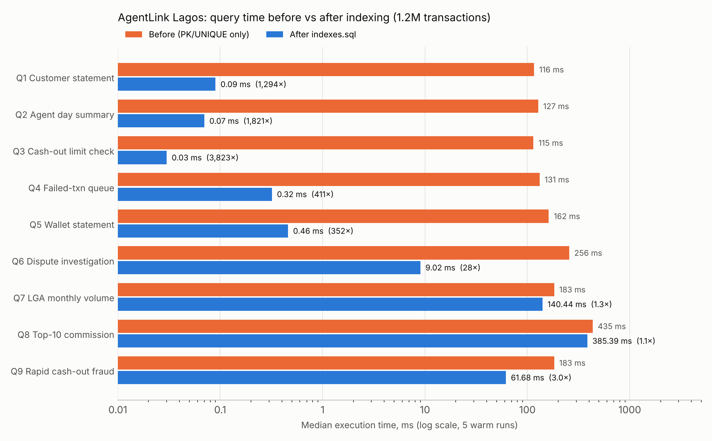

# Portfolio 2: Query Processing and Optimisation

All numbers below come from PostgreSQL 16 `EXPLAIN (ANALYZE, BUFFERS)` on the Portfolio 1 dataset (1,209,721 transactions, 3,223,039 ledger rows). Each timing is the **median of 5 warm runs** after one warm-up run.

## Files

| File | Purpose |
|---|---|
| `queries.sql` | 9 real business queries for AgentLink (each tagged `-- @Qn`) |
| `indexes.sql` | 7 indexes, each linked to the query whose plan justified it |
| `benchmark.py` | Drops the indexes → runs all queries → builds indexes → runs again; writes plans, CSV and write-cost test |
| `plans/before/*.txt`, `plans/after/*.txt` | Full execution plans for every query, before and after |
| `results.csv`, `query_times_before_after.png` | Timing table and chart |
| `index_sizes_and_write_cost.txt` | Storage cost and INSERT slowdown caused by the indexes |
| `rewrites.sql` → `evidence_rewrites.txt` | Query-rewrite experiments (sargability, NOT IN bug, materialized view, statistics) |

Run: `python3 benchmark.py && python3 make_chart.py && psql -d agentlink -f rewrites.sql > evidence_rewrites.txt`

## Results

| Query | Before (ms) | Access path before | After (ms) | Access path after | Speed-up |
|---|---:|---|---:|---|---:|
| Q1 Customer mini-statement | 116.45 | Parallel Seq Scan + Sort | 0.09 | Index Scan `idx_txn_customer_time` (no sort) | ~1,300× |
| Q2 Agent end-of-day | 127.45 | Seq Scan | 0.07 | **Index Only Scan** `idx_txn_agent_time` | ~1,800× |
| Q3 Cash-out limit check | 114.70 | Seq Scan | 0.03 | **Index Only Scan**, 4 buffers, 0 heap fetches | ~3,600× |
| Q4 Failed-txn queue | 131.47 | Seq Scan | 0.32 | Partial index `idx_txn_failed_time` (1.1 MB) | ~410× |
| Q5 Wallet statement | 161.83 | Seq Scan on ledger | 0.46 | Index Scan `idx_ledger_wallet_time` | ~350× |
| Q6 Dispute investigation | 256.40 | Seq Scan ledger (3.2M rows) + hash join | 9.02 | Nested loop using `idx_ledger_txn` | 28× |
| Q7 LGA monthly volume | 182.62 | Parallel Seq Scan | 140.44 | Nested loop over 3,000 agents, Index Only Scan | 1.3× |
| Q8 Top-10 commission | 434.72 | Seq Scans + hash joins | 385.39 | BRIN bitmap scan on Oct; commission still seq-scanned | 1.1× |
| Q9 Rapid cash-out fraud | 182.56 | Seq Scan + Sort | 61.68 | Index Only Scan on partial index (pre-sorted) | 3.0× |

## Analysis

**1. Point and short-range lookups gain the most (Q1–Q5).** Before indexing, every query read all 33,000+ pages of `pos_transaction` (`Buffers: shared hit=26136 read=7232` in `plans/before/Q1.txt`) to return 20 rows. The composite index `(customer_id, created_at DESC)` matches both the filter and the `ORDER BY`. PostgreSQL walks the first 20 index entries and stops: 23 buffers, no Sort node. These are the queries that run on every POS tap, so this is where performance matters most.

**2. Covering index → Index-Only Scan (Q2, Q3).** The cash-out limit check (Q3) runs before *every* withdrawal. Adding `INCLUDE (type_code, status, amount, fee)` means the answer is read from the index leaf pages alone (`Heap Fetches: 0`). That only works because `VACUUM` has set the visibility map. This is one reason autovacuum must not be disabled.

**3. Partial and BRIN indexes are small.** Only about 4% of rows are FAILED, so the partial index for Q4 is **1.1 MB**, compared with 36–96 MB for the full B-trees. Rows are inserted in time order, so `created_at` is physically correlated with the table and a **BRIN index is just 24 kB**. It let Q8 skip the blocks outside October (`Heap Blocks: lossy=6128`).

**4. Indexes do not fix large aggregations (Q7, Q8).** October is about one-sixth of the table, and Q8 must also read all 889k commission rows. When a query needs a large share of the rows, a sequential scan is already close to optimal, and the planner correctly chooses it or a similar plan. The fix is to **reduce the data read**: in `rewrites.sql` (R3), a materialized view of per-agent monthly totals answers Q8 in **3.0 ms instead of 330 ms (~110×)**. An `EXCEPT` check confirms the same top 10. The cost is a 2.5 s `REFRESH ... CONCURRENTLY`, scheduled nightly, so the report can be up to a day stale. Portfolio 5 also uses monthly range partitioning, which lets the planner prune whole months.

**5. Rewrites that matter (from `evidence_rewrites.txt`):**
* **Sargability.** `created_at::date = '2026-10-15'` turns the date into a *Filter* applied to all 1,286 rows of agent 57 (0.71 ms). The half-open range `created_at >= … AND < …` becomes part of the *Index Cond* and reads only 7 rows (0.03 ms), about 22× faster.
* **NOT IN is a correctness trap.** Walk-in card customers have `customer_id IS NULL`. `NOT IN (subquery containing NULL)` therefore returns **0 rows**, while `NOT EXISTS` correctly returns **18,001 customers**. The planner runs NOT EXISTS as a hash anti-join.
* **Statistics.** The planner estimated 17 rows for `status = 'PENDING'` and the actual was 7. Estimates come from `pg_stats` (most-common values: SUCCESS 95.1%, FAILED 4.1%). Running `ANALYZE` after the bulk load is what makes these estimates reliable.

**6. Indexes have a price.** The 7 indexes add **276 MB** of storage, and inserting 50,000 transactions went from **1,722 ms to 2,024 ms (1.18× slower)**. Each index has to be maintained on every write. For a write-heavy POS system I kept only the indexes that serve frequent, latency-sensitive queries and used partial/BRIN indexes where possible. Rare analytical reports use the materialized view instead of more indexes.

## Link to course material
Study Session 4 (query optimisation, execution plans, cost estimation, file organisation): the plans show the optimiser choosing between sequential, index, index-only and bitmap access paths based on estimated cost. BRIN and partitioning relate directly to how records are physically organised in files.
