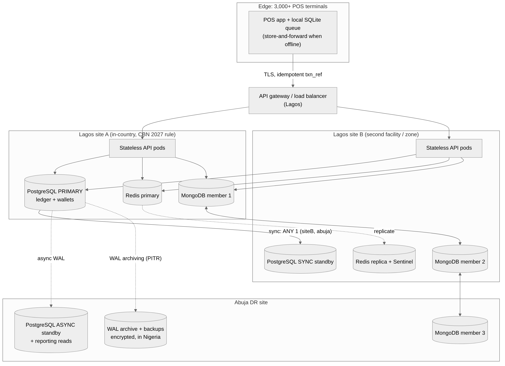

# Portfolio 5: Distributed and Cloud Database Exercise

This portfolio takes AgentLink from one server to several, testing replication, fragmentation, sharding, availability and consistency for real on multiple database processes, and then designs a cloud deployment that meets Nigerian regulation.

## Files

| File | What it sets up / proves | Evidence |
|---|---|---|
| `01_pg_replication.sh` | PostgreSQL primary + hot standby (streaming replication), sync vs async, failover | `evidence_pg_replication.txt` |
| `02_partitioning.sql` | Monthly range partitions (horizontal fragmentation), pruning, DETACH for archiving, list fragments by region | `evidence_partitioning.txt` |
| `03_mongo_replicaset.py` | 3-node MongoDB replica set: w:majority, secondary reads, multi-document transaction, failover under load, majority loss | `evidence_mongo_replicaset.txt` |
| `04_mongo_sharding.py` | Sharded cluster (config server + 2 shards + mongos) with **zone sharding by Lagos region** | `evidence_mongo_sharding.txt` |
| `cloud_architecture.mmd/.png` | Target production deployment | — |

All of these ran on one Linux host, with each node as a separate server process on its own port (PostgreSQL 16.15, MongoDB 8.3.7). Network latency between real sites is therefore not represented; everything else (protocols, elections, routing) is the real behaviour.

## A. PostgreSQL streaming replication (`evidence_pg_replication.txt`)

| Step | Result |
|---|---|
| R0 Base backup | 1.2 GB copied with `pg_basebackup -R` in 2 s. Standby reports `pg_is_in_recovery() = t` |
| R1 Primary's view | `replica1 · streaming · async`, sent_lsn = replay_lsn |
| R2 Read-your-write on replica | Row committed on primary was visible on the replica **38 ms** later. Replay lag 3 ms, `bytes_behind = 0` |
| R3 Bulk | 50,000 rows on primary = 50,000 on replica |
| R4 Standby is read-only | `ERROR: cannot execute UPDATE in a read-only transaction` |
| R5 Read scaling | October volume report (193,954 txns, ₦4.50 bn) served by the replica, not the primary |
| R6 Synchronous mode | `sync_state = sync`, commit 2.1 ms (waits for the standby) |
| R7 **Sync standby down** | The primary **could not acknowledge** a commit. It was still waiting on `SyncRep` after 4 s, until an operator cancelled it. PostgreSQL then warned that the transaction *"has already committed locally, but might not have been replicated"* |
| R8 Async mode | Commit returned in 1.1 ms with the standby down. On restart the standby caught up from WAL (rows −1, −2, −3 present) |
| R9 **Failover** | Primary crashed (`stop -m immediate`), replica promoted in **0.14 s**, and the last write before the crash (−4) survived |

**CAP interpretation.** R7 is the CAP theorem in practice. During a partition (standby unreachable), synchronous replication chose **consistency**: no acknowledged commit can be lost, but the system stopped accepting writes. Asynchronous replication (R8) chose **availability**, at the cost of a window where acknowledged commits exist on only one node (RPO > 0). R7 also shows a subtle detail: a cancelled synchronous commit is *not* rolled back. The client gets a warning, not an error, so the application must treat that outcome as "unknown" and reconcile (which the `txn_ref` idempotency in P3 makes possible).

## B. Fragmentation / partitioning (`evidence_partitioning.txt`)

* Six monthly fragments of about 200k rows (21–22 MB each). The October report scanned **only `txn_2026_10`** (partition pruning), in 33 ms.
* On the unpartitioned table, the BRIN index from Portfolio 2 gave a similar 37 ms. So for this query **pruning and BRIN perform about the same**. The real gain from partitioning is **lifecycle management**: removing May took **1.6 ms with `DETACH PARTITION`** against **67 ms for a row-by-row `DELETE`**, and the DELETE also leaves dead tuples behind for VACUUM. Retention, archiving and per-month maintenance are why I would partition the ledger in production.
* `agent_frag` list-partitions agents by region (391 Island / 2,610 Mainland). This is the course's *horizontal fragmentation by site*, done here inside one database and done across machines with MongoDB in part D.

## C. MongoDB replica set (`evidence_mongo_replicaset.txt`)

* 20,000 receipts written with `w:"majority"` in 0.50 s and the same count read from a secondary.
* **Multi-document ACID transaction:** Ada→Bayo ₦5,000 committed. A second transfer that failed after the debit was **aborted, and the debit rolled back**. NoSQL does not always mean "no transactions".
* **Failover under load:** a POS simulator wrote every 50 ms with `retryWrites`. After `kill -9` on the primary, a **new primary was elected in about 10.4 s** (MongoDB's default 10 s election timeout). **95 of 95 writes succeeded.** The slowest write took 10.3 s, because the driver held and retried it instead of failing. The old primary rejoined as a SECONDARY.
* **Majority lost:** with 2 of 3 nodes down, the survivor stepped down to SECONDARY and **rejected writes (`NotPrimaryError`)**, but still served (possibly stale) reads with `secondaryPreferred`. This is CP for writes, with optional availability for reads.

## D. MongoDB zone sharding (`evidence_mongo_sharding.txt`)

Shard key `{agent.lga: 1, _id: 1}`: LGA first for locality, then `txn_ref` for cardinality so that chunks can still split. Zones: **ISLAND** = Eti-Osa, Lagos Island, Ibeju-Lekki, Epe → `shIsland`; all others → `shMainland`.

| Query (through mongos) | Routing | Shards |
|---|---|---|
| Failed txns in Eti-Osa | `SINGLE_SHARD` (targeted) | shIsland |
| One receipt by LGA + ref | `SINGLE_SHARD`, 1 ms | shMainland |
| Customer 1234's receipts (no shard key) | `SHARD_MERGE` (scatter-gather), 184 ms | both |
| LGA volume aggregation | `$match`+`$group` on each shard, final `$group` on mongos | both |

Distribution: 174,409 receipts on Mainland and 29,637 on Island. The split is **deliberately uneven**: zones optimise locality, not balance. A national rollout would use zones per region (Lagos, Abuja, Kano…) so that each region's data lives in that region. The trade-off is that customer-centric queries become scatter-gather. The fix would be a secondary collection keyed by customer, or a hashed key if balance mattered more than locality.

## E. Cloud deployment design

**Regulatory constraints (verified November 2026):**
1. The **CBN circular of 15 June 2026** requires payment transaction data generated in Nigeria to be **stored and managed in Nigeria by 1 January 2027**. It is addressed explicitly to super agents and payment terminal service providers, which is exactly AgentLink's type of business. All primary, replica **and backup** copies of the ledger must therefore be in Nigeria.
2. The **Nigeria Data Protection Act 2023, sections 41–43** (with the NDPC's GAID 2025) only allow personal data to leave Nigeria on an adequacy decision, an approved transfer instrument, or another lawful basis. This rules out casually sending customer data to a foreign region for analytics.

**Where to host.** The **AWS Lagos Local Zone (`af-south-1-los-1a`)** is an extension of the Cape Town region. Its published services are compute and storage (EC2, EBS, ECS, EKS, ALB, Direct Connect). I could not confirm managed RDS there, so the ledger would be **self-managed PostgreSQL on EC2 (with Patroni for automatic failover)**. EBS snapshots must be kept from defaulting to S3 in South Africa. Nigerian clouds and data centres (e.g., MTN Cloud, Nobus at Rack Centre, Layer3 in Lagos and Abuja) can provide the second Lagos site and the Abuja DR site. A **managed service in Cape Town (e.g., RDS Multi-AZ)** would be operationally simpler, but after 1 January 2027 it would not satisfy the CBN rule for payment data.

**Design decisions taken from the experiments above**

| Store | Topology | Consistency choice | Why (evidence) |
|---|---|---|---|
| PostgreSQL ledger | Primary (Lagos A) + sync standby (Lagos B) + async standby (Abuja) | `synchronous_standby_names = 'ANY 1 (siteB, abuja)'` | Quorum sync gives zero data loss **without** the R7 outage when one standby fails. Abuja doubles as the reporting replica (R5) |
| PostgreSQL ledger | Monthly partitions, WAL archiving to in-country object storage | PITR | Retention via DETACH (B), recovery to any second |
| MongoDB receipts/telemetry | 3-member replica set, one per site; zone sharding when national | `w:"majority"` writes, `secondaryPreferred` for reports | Survives loss of any one site (C). Zones keep regional data local (D) |
| Redis | Primary + replica + Sentinel | Best-effort | Data is rebuildable from PostgreSQL (P4) |
| POS edge | Local SQLite queue on terminal | Store-and-forward, idempotent `txn_ref` | Lagos connectivity drops (course Session 5: edge databases). Retries are safe (P3 D12) |

**Availability target.** The PostgreSQL failover itself took 0.14 s here, but a production failover is dominated by detection and reconnection (Patroni TTL, connection pools). MongoDB took about 10 s by default (C). A realistic target is under 30 s of write interruption with RPO = 0 for the ledger, and RPO measured in seconds for receipts.

### Sources
* CBN payment-data localisation circular (15 June 2026): [Mondaq: CBN's Data Localisation Directive](https://www.mondaq.com/cbns-data-localisation-directive-compliance-considerations-for-payment-system-participants/1812264), [BusinessDay](https://businessday.ng/technology/article/cbn-ends-offshore-payment-processing-as-banks-fintechs-face-2027-data-localisation-deadline/), [Arise TV: CBN holds firm on January 2027 deadline](https://www.arise.tv/cbn-holds-firm-on-january-2027-data-deadline-orders-banks-to-localise-payment-data/)
* NDPA 2023 cross-border transfers and GAID 2025: [ALN: What Constitutes Cross-Border Transfer](https://aln.africa/?p=7017), [Digital Policy Alert: GAID 2025](https://digitalpolicyalert.org/event/28383-nigeria-data-protection-act-2023-general-application-and-implementation-directive-2025-ndpcndp-act-gaid012025-including-cross-border-data-transfer-regulation-was-adopted-by-nigeria-data-protection-commission)
* AWS Lagos Local Zone: [AWS What's New (Jan 2023)](https://aws.amazon.com/about-aws/whats-new/2023/01/aws-local-zones-lagos-lima-queretaro/), [AWS: Available Local Zones](https://docs.aws.amazon.com/local-zones/latest/ug/available-local-zones.html), [AWS Local Zones features](https://aws.amazon.com/about-aws/global-infrastructure/localzones/features/)
* Amazon RDS Multi-AZ: [AWS RDS Multi-AZ](https://aws.amazon.com/rds/features/multi-az), [AWS user guide](https://docs.aws.eu/AmazonRDS/latest/UserGuide/Concepts.MultiAZSingleStandby.html)
* Nigerian cloud providers: [Lineserve: Cloud providers in Nigeria (2026)](https://www.lineserve.net/blog/cloud-providers-in-nigeria)
